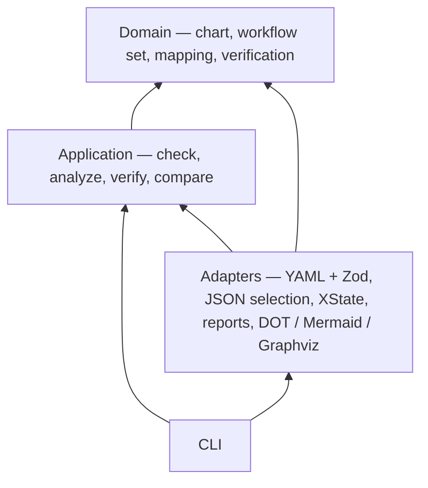

# 🧶 Clew

Agents turn plain-English workflows into XState machines. Clew checks a state chart, checks a workflow set, and proves each named flow. The exported visuals are the human-facing contract and proof.

Clew is the ball of thread Ariadne gave Theseus: a proven path through the maze.

The command contract, JSON shapes, and file format are in [docs/agent-cli.md](docs/agent-cli.md).

## Install

Clew is published as a tarball on GitHub Releases. Install that file. The tarball includes Clew's runtime dependencies, so this install does not use the npm registry.

```bash
npm install -g https://github.com/goan15910/clew/releases/download/v0.1.0/clew-0.1.0.tgz
clew --help
```

The asset name is `clew-<version>.tgz`, and the tag is `v` plus the version in `package.json`. The same release includes `SHA256SUMS`. Check it with `sha256sum -c SHA256SUMS`. v0.1.0 appears after that tag is pushed.

Image export needs Graphviz (`dot`, `gvpack`, `neato`) on your `PATH`. `clew verify` proves flows without it. Charts are written only when you pass `--out`.

From a checkout, `npm install` then `npm run build`. `npm run clew` runs the TypeScript source. `npm test` runs the built CLI.

## Quick start

Image export needs Graphviz (`dot`, `gvpack`, `neato`). Reports and charts are written only when you pass `--out`.

```bash
npm install
npm run --silent clew -- chart check <chart.yaml> [--json]
npm run --silent clew -- chart analyze <chart.yaml> [--json]
npm run --silent clew -- workflows check <workflows.yaml> [--json]
npm run --silent clew -- verify <chart.yaml> <workflows.yaml> <mapping.yaml> [--flow W8] [--select file] [--out dir] [--highlight W2] [--json]
npm run --silent clew -- compare <verify.json>... [--out dir] [--json]
npm run --silent clew -- spec init <spec.md> [--session id] [--json]
npm run --silent clew -- spec tag [--session id] [--sentence s1] [--json]
```

`--silent` keeps npm's own banner off stdout, so a `--json` document stays one JSON value.

`clew --help` lists the commands. There are no prompts, and Clew does not read stdin.

Exit codes:

- `0` — the check passed, the analysis is clean, every selected flow passed, compare has a winner, or spec init/tag left no blocking findings
- `1` — schema or graph invalid, the analysis found an unreachable state or a dead end, a flow failed, compare has no winner, or a spec command reported a blocking finding
- `2` — unreadable input, bad arguments, a missing spec session, or a verify/analyze precondition failed

Errors go to stderr. `--json` prints one result document on stdout.

The to-do example is in `examples/todo/`. `b-full` passes all eight workflows. `a-basic` fails W6, W7, and W8. The workflow set and the chart use different names; `mapping.yaml` is the correspondence.

`examples/spec/order.md` is a plain-English spec for `clew spec init` and `clew spec tag`. The session is stored outside the repo. See [docs/agent-cli.md](docs/agent-cli.md).

## Tests

Venom drives the commands in [docs/agent-cli.md](docs/agent-cli.md): `chart check`, `chart analyze`, `workflows check`, `verify`, `compare`, `--json` chaining, exit codes, and stderr. The suites are `tests/venom/`. Boundary charts and workflow sets live in `tests/fixtures/`. `examples/todo/` is the walkthrough.

```bash
bash scripts/install-venom.sh
bin/venom run tests/venom --format=xml --output-dir=venom-results --html-report --var "root=$PWD" --var "clew=node_modules/.bin/tsx src/cli.ts"
```

Venom is pinned to v1.3.0. GitHub Actions runs the same command on pull requests and on `main`, in the `venom` workflow.

Open that run and read the venom job summary. It has one row per suite (suite, tests, passed, failed, time) and a collapsible section per suite. Each test is listed there, failures first, with the assertion text. A failing case is also an annotation on the run and on the pull request, on that test's line in `tests/venom/`.

The `venom-report` artifact on the same run contains the JUnit XML, the HTML report, and `venom.log`. GitHub keeps the artifact for 14 days.

## Architecture

The CLI is the composition root. It parses arguments, wires adapters into the use cases, and maps each result to stdout, stderr, and an exit code. Use cases depend only on domain objects and ports. Adapters implement those ports. Dependencies point inward.



An arrow means "depends on".

The domain holds states, transitions, typed data fields, guards, effects, named workflow lists, the mapping between the two vocabularies, and the verification results. Invariants live there. It does not import XState, Zod, YAML, the file system, or Graphviz. Zod runs only while reading a YAML file, a JSON selection, or the command line. The XState and `@xstate/graph` engine, the JSON and Markdown writers, and the diagram renderer are adapters behind ports.

`npm run check:dependencies` fails when an import points the wrong way. `npm run check` runs that together with `tsc --noEmit`.

## Your files

**Chart.** A YAML file. Clew validates it with Zod once, then builds a flat XState machine with `createMachine`. Guards and effects are named declarations, not code. Nested and parallel states are out of scope. The chart does not name workflow states.

```yaml
id: todoTask
initial: draft
guards:
  - { name: titleNotEmpty, reads: title }
effects:
  - { name: markListed, sets: listed }
states:
  - id: draft
    label: Draft
    data:
      title: string
  - id: todo
    label: Todo
    data:
      listed: boolean
transitions:
  - { from: draft, event: SUBMIT, to: todo, actor: user, guard: titleNotEmpty, effect: markListed }
```

State ids are camelCase. Events are `UPPER_SNAKE_CASE`. Each state declares `data` fields as `string`, `boolean`, `number`, or `timestamp`. A guard may only read a field declared on the source state. An effect may only set a field declared on the target state. The initial state and every transition target are checked when the file is loaded. `final: true` marks a state that must not have outgoing transitions.

**Workflow set.** A YAML file of named linked lists. Each workflow is one disconnected sub-graph. Node `state` and edge `event` use the workflow vocabulary, not chart ids.

```yaml
id: todoFlows
workflows:
  - id: W1
    title: Happy path
    expect: accepted
    start: edit
    nodes:
      - { id: edit, state: editing }
      - { id: finished, state: closed }
    edges:
      - { from: edit, event: submit, to: finished, text: "Finish the work" }
```

`expect: rejected` sets `rejectAt` to the edge the chart must refuse. The full rules are in [docs/agent-cli.md](docs/agent-cli.md).

**Mapping.** A third YAML file, passed only to `verify`. It pairs chart states with workflow states and chart events with workflow events, and it names which chart and workflow set it applies to.

```yaml
chart: todoTask
workflowSet: todoFlows
states:
  - { chart: draft, workflow: editing }
  - { chart: done, workflow: closed }
events:
  - { chart: SUBMIT, workflow: submit }
```

`--highlight W2` draws that workflow's path on the state chart when you also pass `--out`. `--select` takes the JSON from `workflows check` (or `{ "flows": ["W1"] }`) and verifies only those named sub-graphs.

## Visuals

Overall state chart:


*Overall state chart.*

W2, Snooze and resume:


*W2 "Snooze and resume": traversal path highlighted.*

Workflow proofs:


*W1–W8, with W8 refused as required.*
