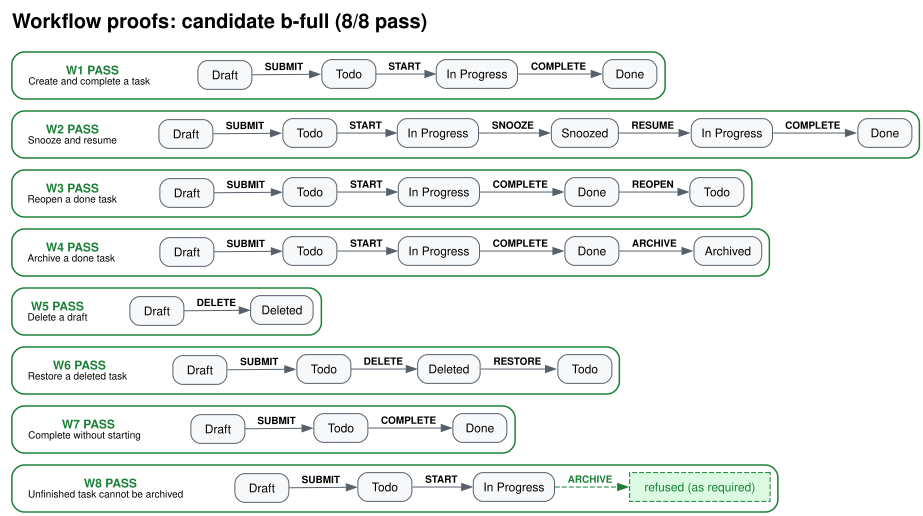
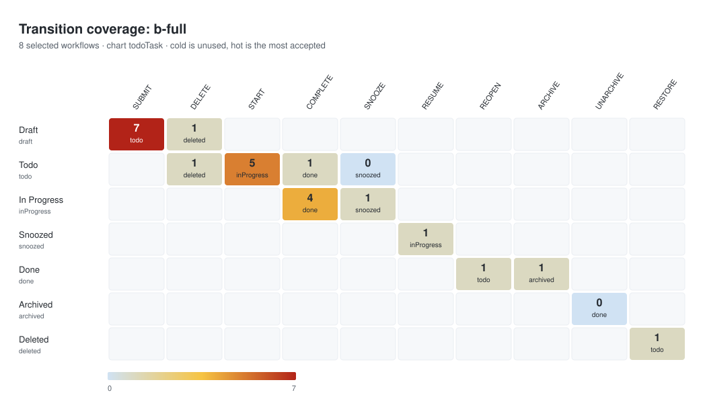
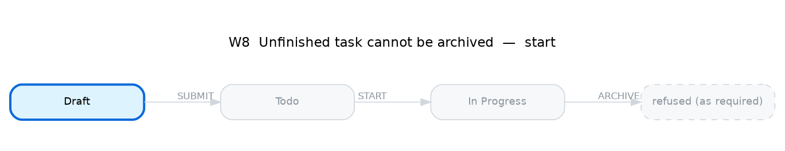

# 🧶 Clew

Agents turn plain-English workflows into XState machines. Clew checks a state chart, checks a workflow set, and proves each named flow. The exported visuals are the human-facing contract and proof.

Clew is the ball of thread Ariadne gave Theseus: a proven path through the maze.

The command contract, JSON shapes, and file format are in [docs/agent-cli.md](docs/agent-cli.md).

## Install

Clew is published as a tarball on GitHub Releases. Install that file. The tarball includes Clew's runtime dependencies, so this install does not use the npm registry.

```bash
npm install -g https://github.com/goan15910/clew/releases/download/v0.1.0-alpha.2/clew-0.1.0-alpha.2.tgz
clew --help
```

The asset name is `clew-<version>.tgz`, and the tag is `v` plus the version in `package.json`. The same release includes `SHA256SUMS`. Check it with `sha256sum -c SHA256SUMS`. Another release uses that version in the tag and in the asset name.

Image export needs Graphviz 16.1.0 (`dot`, `gvpack`, `neato`) on your `PATH`. Ubuntu's `apt install graphviz` is 2.42; `bash scripts/install-graphviz.sh` installs 16.1.0. `clew verify` proves flows without Graphviz. Charts are written only when you pass `--out`. `--heatmap` writes an SVG coverage matrix and does not need Graphviz. `--replay` writes one GIF per selected workflow and uses `neato`.

From a checkout, `npm install` then `npm run build`. `npm run clew` runs the TypeScript source. `npm test` runs the built CLI.

## Quick start

Image export needs Graphviz 16.1.0 (`dot`, `gvpack`, `neato`). Reports and charts are written only when you pass `--out`. `--heatmap` and `--replay` also need `--out`. See [docs/agent-cli.md](docs/agent-cli.md) for attribute tables, actor colors, dashed guards, clusters, and highlighted paths.

```bash
npm install
npm run --silent clew -- help [command...]
npm run --silent clew -- chart check <chart.yaml> [--json]
npm run --silent clew -- chart analyze <chart.yaml> [--json]
npm run --silent clew -- workflows check <workflows.yaml> [--json]
npm run --silent clew -- verify <chart.yaml> <workflows.yaml> [--flow W8] [--select file] [--highlight W2] [--heatmap] [--replay] [--out dir] [--json]
npm run --silent clew -- compare <verify.json>... [--out dir] [--json]
npm run --silent clew -- spec init <spec.md> [--session id] [--json]
npm run --silent clew -- spec tag [--session id] [--sentence s1] [--json]
npm run --silent clew -- spec entities list [--kind actor] [--status candidate] [--session id] [--json]
npm run --silent clew -- spec facts propose [--sentence s1] [--session id] [--json]
npm run --silent clew -- spec graph build [--session id] [--json]
npm run --silent clew -- spec graph split --id W1 --at 2 [--session id] [--json]
npm run --silent clew -- spec graph group --id W1 --id W2 [--title text] [--session id] [--json]
npm run --silent clew -- spec emit (--dry-run | --out file) [--force] [--session id] [--json]
npm run --silent clew -- spec trace <id> [--session id] [--json]
npm run --silent clew -- spec status [--session id] [--json]
npm run --silent clew -- spec session list [--json]
npm run --silent clew -- spec session remove <id> [--json]
```

`--silent` keeps npm's own banner off stdout, so a `--json` document stays one JSON value.

`clew --help` lists the top-level commands. `clew help` lists every command. `clew help <command>` prints that command's examples and exit codes. There are no prompts, and Clew does not read stdin.

Exit codes:

- `0` — the check passed, the analysis is clean, every selected flow passed, compare has a winner, or a spec command left no blocking findings
- `1` — schema or graph invalid, the analysis found an unreachable state or a dead end, a flow failed, compare has no winner, or a spec command reported a blocking finding
- `2` — unreadable input, bad arguments, a missing spec session, or a verify/analyze precondition failed

Errors go to stderr. `--json` prints one result document on stdout.

The to-do example is in `examples/todo/`. Workflow state and event names are the chart's names. There is no mapping file. `b-full` passes all eight workflows. `a-basic` fails W6, W7, and W8: it never declares `RESTORE`, it has no `COMPLETE` from `todo`, and it accepts `ARCHIVE` from In Progress. Dropping the mapping file is a breaking change. The version in `package.json` is unchanged.

`examples/spec/order.md` is a plain-English spec for `clew spec init`, `clew spec tag`, `clew spec entities`, `clew spec facts`, `clew spec graph`, and `clew spec emit`. The session is stored outside the repo. `clew spec session list` shows the sessions for this repo, and `clew spec session remove <id>` deletes one of them. See [docs/agent-cli.md](docs/agent-cli.md).

## Tests

Venom drives the commands in [docs/agent-cli.md](docs/agent-cli.md): `chart check`, `chart analyze`, `workflows check`, `verify`, `compare`, `spec init`, `spec tag`, `spec entities`, `spec facts`, `spec graph`, `spec emit`, `spec trace`, `spec status`, `spec session list`, `spec session remove`, `--heatmap`, `--replay`, `--json` chaining, exit codes, and stderr. The suites are `tests/venom/`. Boundary charts and workflow sets live in `tests/fixtures/`. `examples/todo/` is the walkthrough.

```bash
bash scripts/install-venom.sh
bin/venom run tests/venom --format=xml --output-dir=venom-results --html-report --var "root=$PWD" --var "clew=node_modules/.bin/tsx src/cli.ts"
```

Venom is pinned to v1.3.0. GitHub Actions runs the same command on pull requests and on `main`, in the `venom` workflow.

Open that run and read the venom job summary. It has one row per suite (suite, tests, passed, failed, time) and a collapsible section per suite. Each test is listed there, failures first, with the assertion text. A failing case is also an annotation on the run and on the pull request, on that test's line in `tests/venom/`.

The `venom-report` artifact on the same run contains the JUnit XML, the HTML report, and `venom.log`. GitHub keeps the artifact for 14 days.

## Architecture

The CLI is the composition root. It parses arguments, wires adapters into the use cases, and maps each result to stdout, stderr, and an exit code. Use cases depend only on domain objects and ports. Adapters implement those ports. Dependencies point inward.


An arrow means "depends on".

The domain holds states, transitions, typed data fields, guards, effects, named workflow lists, and the verification results. A workflow state name is a chart state id, and a workflow event is a chart event. Invariants live there. It does not import XState, Zod, YAML, the file system, Graphviz, or the GIF encoder. Zod runs only while reading a YAML file, a JSON selection, or the command line. The XState and `@xstate/graph` engine, the JSON and Markdown writers, and the diagram renderer are adapters behind ports.

`npm run check:dependencies` runs dependency-cruiser. Domain modules import only the domain. Application modules import the domain, other application modules (including ports), and `node:path`. Adapters import inward and may use libraries. The CLI is the composition root. Cycles fail the check. Type-only imports count, and `tsconfig` `paths` are resolved. `npm run check:imports` runs Semgrep on local rules, with no Semgrep account: the domain may not import XState, Zod, YAML, the file system, Graphviz, application, or adapters. Both are steps in the `check` job. Planted violations live in `tests/architecture/plants` and are outside that product scan. `npm run check` runs the typecheck, both gates, and the tests.

## Your files

**Chart.** A YAML file. Clew validates it with Zod once, then builds a flat XState machine with `createMachine`. Guards and effects are named declarations, not code. Nested and parallel states are out of scope. Workflow files use these state ids and event names.

```yaml
id: todoTask
initial: draft
guards:
  - { name: titleNotEmpty, reads: title }
effects:
  - { name: markListed, sets: listed }
states:
  - id: draft
    label: Draft
    data:
      title: string
  - id: todo
    label: Todo
    data:
      listed: boolean
transitions:
  - { from: draft, event: SUBMIT, to: todo, actor: user, guard: titleNotEmpty, effect: markListed }
```

State ids are camelCase. Events are `UPPER_SNAKE_CASE`. `spec emit` writes that same convention from kebab-case spec names (`mark-shipped` becomes event `MARK_SHIPPED`; `in-progress` becomes state `inProgress`). Node ids stay kebab-case. Each state declares `data` fields as `string`, `boolean`, `number`, or `timestamp`. A guard may only read a field declared on the source state. An effect may only set a field declared on the target state. The initial state and every transition target are checked when the file is loaded. `final: true` marks a state that must not have outgoing transitions.

**Workflow set.** A YAML file of named linked lists. Each workflow is one disconnected sub-graph. A node's `state` is the chart state id. An edge's `event` is the chart event. Node ids are local, so one state can be visited twice.

```yaml
id: todoFlows
workflows:
  - id: W1
    title: Happy path
    expect: accepted
    start: edit
    nodes:
      - { id: edit, state: draft }
      - { id: finished, state: done }
    edges:
      - { from: edit, event: SUBMIT, to: finished, text: "Finish the work" }
```

`expect: rejected` sets `rejectAt` to the edge the chart must refuse. `verify` matches those names exactly. A workflow state that is not on the chart exits 2. An event the chart never declares fails only that flow (exit 1). The full rules are in [docs/agent-cli.md](docs/agent-cli.md).

`--highlight W2` draws that workflow's path on the state chart when you also pass `--out`. `--select` takes the JSON from `workflows check` (or `{ "flows": ["W1"] }`) and verifies only those named sub-graphs.

## Visuals

Overall state chart:


*State chart. Each state is an attribute table. Edges are colored by actor, guarded edges are dashed, and states are grouped by the actor who leaves them.*

W2, Snooze and resume:


*W2 "Snooze and resume": that path is blue and numbered. The rest of the chart is faded.*

Workflow proofs:



*W1–W8. Each workflow is its own cluster. W8 is refused, as required.*

Transition coverage for `b-full`. Cold cells were not accepted by any of the eight workflows. SUBMIT is hot because seven workflows accept it. W8's refused archive is not a cell: that step is not coverage.



*Transition coverage: b-full.*

W8 replay. The last frame is the archive step the chart refuses.



*W8 on b-full, ending on the refused step.*
