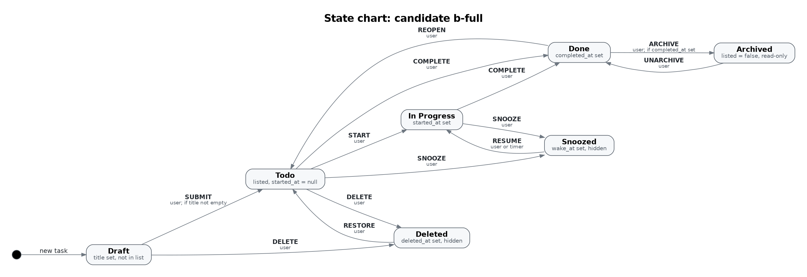
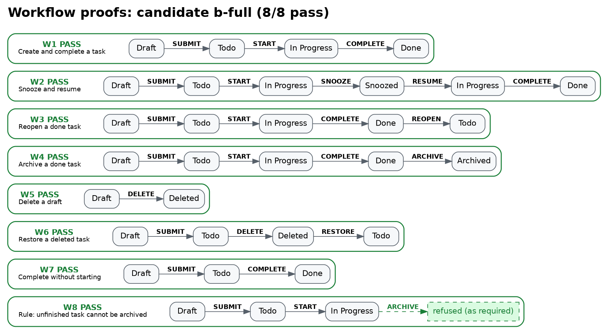

# Clew

Agents turn plain-English workflows into XState machines. Clew checks each machine against the contract, structural checks, and traversal proofs. The exported visuals are the human-facing contract and proof.

Clew is the ball of thread Ariadne gave Theseus: a proven path through the maze.

## Quick start

Image export needs Graphviz (`dot`, `gvpack`, `neato`).

```bash
npm install
npm run demo
npm run demo:invalid
```

`npm run demo` compares two candidate to-do machines against `inputs/workflows.yaml` and writes reports and charts under `out/`. `npm run demo:invalid` runs the same checks on two machines the contract must reject (`out/invalid/`).

```bash
npm run clew -- verify <machine.ts> <workflows.yaml> [--out dir] [--highlight W2]
npm run clew -- compare <workflows.yaml> <machine.ts>... [--out dir] [--highlight W2]
```

Exit code is 0 only when every workflow passes (`verify`) or a candidate passes all of them (`compare`).

## Layout

- `src/contract.ts` — reads a machine into a flat contract and validates it with Zod
- `src/verify.ts` — reachability, dead ends, and workflow traversal (`@xstate/graph`)
- `src/render.ts` — Graphviz and Mermaid export
- `src/cli.ts` — `clew verify` and `clew compare`
- `inputs/` — plain-English workflows (`workflows.en.md`) and the machine-facing `workflows.yaml`
- `candidates/` — example machines (`a-basic`, `b-full`)
- `examples-invalid/` — machines the contract must reject
- `out/` — reports and visuals from the demo

## `workflows.yaml` `expect`

Each workflow is a sequence of events plus an expectation:

- **accepted → final state** (`end`): the sequence must be possible and finish in that state
- **rejected at step N** (`rejectAt`): the machine must refuse the sequence at that step

## Demo

| Candidate | Result | Failed |
|---|---|---|
| b-full | 8/8 | none |
| a-basic | 5/8 | W6, W7, W8 |

**Winner: b-full.** a-basic cannot restore a deleted task (W6), cannot complete without starting (W7), and archives an unfinished task that the rule says to refuse (W8).

State chart for b-full:



Workflow chains for b-full (8/8 pass):


