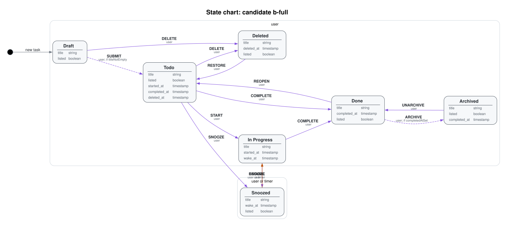
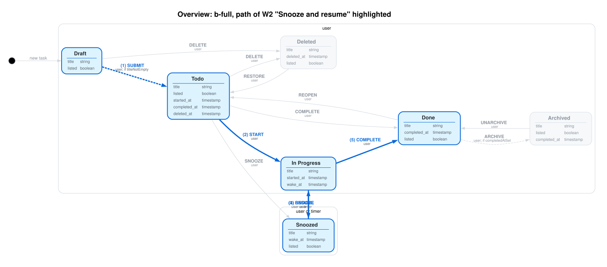

# Clew

Agents turn plain-English workflows into XState machines. Clew checks each machine against the contract, structural checks, and traversal proofs. The exported visuals are the human-facing contract and proof.

Clew is the ball of thread Ariadne gave Theseus: a proven path through the maze.

## Quick start

Image export needs Graphviz (`dot`, `gvpack`, `neato`).

```bash
npm install
npm run clew -- verify <machine.ts> <workflows.yaml> [--out dir] [--highlight W2]
npm run clew -- compare <workflows.yaml> <machine.ts>... [--out dir] [--highlight W2]
```

Exit code is 0 only when every workflow passes (`verify`) or a candidate passes all of them (`compare`).

## Your files

Pass the paths to your own machine module and workflows file.

**Machine.** A TypeScript module that default-exports an XState v5 machine (`createMachine`). Use a flat machine. On each state, `meta` has `label`, `workflowState`, and `data`. On each transition, `meta` has `actor` and `effect` (`guard` is optional). Events are `UPPER_SNAKE_CASE`, every target state exists, and a final state has no outgoing transitions.

**Workflows.** A YAML file of event sequences:

```yaml
machineId: myMachine
workflows:
  - id: W1
    title: Happy path
    expect: accepted
    end: done
    steps:
      - { text: "Start the work", event: START }
  - id: W2
    title: A step the machine must refuse
    expect: rejected
    rejectAt: 2
    steps:
      - { text: "Start", event: START }
      - { text: "Try the forbidden step", event: ARCHIVE }
```

`expect` is **accepted → final state** (`end`: the sequence must be possible and finish in that state) or **rejected at step N** (`rejectAt`: the machine must refuse the sequence at that step).

`--highlight W2` draws that workflow's path on the state chart. Reports and charts are written to the directory you pass with `--out`.

## Layout

- `src/contract.ts` — reads a machine into a flat contract and validates it with Zod
- `src/verify.ts` — reachability, dead ends, and workflow traversal (`@xstate/graph`)
- `src/render.ts` — Graphviz and Mermaid export
- `src/cli.ts` — `clew verify` and `clew compare`
- `docs/assets/` — illustration SVGs

## Visuals

Overall state chart:



*Overall state chart.*

W2, Snooze and resume:



*W2 "Snooze and resume": traversal path highlighted.*
