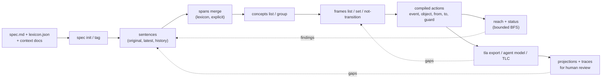

# Spec refinement playbook

How an agent turns a natural-language product spec into a small, checkable state model with Clew, and how it edits Clew's spec layers along the way. This is the process from the first full trial on a real product spec, written up so the next trial can start from it. It is application-agnostic: every example below uses a made-up order-approval domain.

The private trial itself (its spec, context page, edit ledger and numbers) stays offline, per [AGENTS.md](../AGENTS.md). This file holds only the method.

## Contents

1. [Goal and stance](#1-goal-and-stance)
2. [Pipeline at a glance](#2-pipeline-at-a-glance)
3. [The data model an agent edits](#3-the-data-model-an-agent-edits)
4. [Setup](#4-setup)
5. [Order of operations](#5-order-of-operations)
6. [Sentence layer: delete, keep, edit, add](#6-sentence-layer-delete-keep-edit-add)
7. [Writing sentences the tagger reads](#7-writing-sentences-the-tagger-reads)
8. [Span and concept layer](#8-span-and-concept-layer)
9. [Frame layer: relations, guards, non-transitions](#9-frame-layer-relations-guards-non-transitions)
10. [Evidence discipline](#10-evidence-discipline)
11. [Plan files and replay](#11-plan-files-and-replay)
12. [Verification loop](#12-verification-loop)
13. [Keeping the state space small](#13-keeping-the-state-space-small)
14. [From frames to TLA+](#14-from-frames-to-tla)
15. [Projections and traces for review](#15-projections-and-traces-for-review)
16. [Tooling notes](#16-tooling-notes)
17. [Trial-run checklist](#17-trial-run-checklist)

## 1. Goal and stance

The target is a TLA+-style model: one initial valuation plus guarded actions, each action a partial assignment. It is for **workflow verification**: which states the system can reach, in what order, and which steps it refuses. It is not for concurrency. Variables whose only purpose is to state race or locking invariants are left out.

Three rules shape every decision:

- **Backend writes only.** A sentence matters when it changes persisted system state. UI clicks, navigation, previews and human deliberation are not transitions.
- **Every edit is evidence-based.** The agent may delete, rewrite or add sentences and rewire frames, but each write carries a reason that points at a source sentence, a context document, or an explicit assumption.
- **Small enough to check and to look at.** Merge, drop or split variables until each module is easy for TLC and each review view is small enough to draw.

Clew does not call a language model. Its tagger and frame rules are a starting point; the agent is the one who decides what the spec means.

## 2. Pipeline at a glance



Each arrow back is a refinement loop: what verification or a picture exposes goes back into the layer where it belongs, with a reason.

## 3. The data model an agent edits

Full definitions live in [agent-cli.md](agent-cli.md). The parts an agent writes:

| Layer | Unit | What the agent writes | Command |
|---|---|---|---|
| Sentences | `sN` with `original`, `latest`, `history` | add, edit, delete (tombstone) | `spec sentences add/edit/delete` |
| Spans | token windows `sp:sN.tA..sN.tB` | multi-word merges, tags, concept link | `spec spans merge` |
| Concepts | `concept:<canonical>` with member spans | regroup a span into another concept, or unlink it | `spec concepts group` |
| Frames | `fr:sN.tK`, roles `actor`, `event`, `object`, `result`, `when` | set a role, mark not-a-transition | `spec frames set`, `spec frames not-transition` |
| Compiled action | `{ event, object, from, to, guard, kind }` | nothing directly; it follows from the frame | read via `spec frames list` |

Key semantics to keep in mind:

- **One atom variable per frame object.** `result` is the value the object takes. `from` comes from the `when` frame about the same object, else `null`.
- **`when` frames about other objects become the guard.** Several refs to states of one object are alternatives. Prefixing a ref with `every:`, `some:` or `none:` turns it into a count over instances of that object.
- **`kind`** is `action` or `forbidden` (a negated clause such as "cannot cancel"). Forbidden frames become rejected flows.
- **Not-a-transition frames** carry a reason and compile to nothing. Use them for data writes, derived views and invariants that should stay in the spec but not in the state machine.
- **Refinements are kept until their evidence changes.** Editing a sentence that a refinement's `dependsOn` cites drops that refinement back to the derived value and raises `refinement-dropped`.

## 4. Setup

```sh
npm ci && npm run build          # or an installed clew
C="node dist/cli.js"             # every example below uses $C
$C spec init path/to/spec.md --session trial --json > out/init.json
$C spec tag --session trial --json > out/tag.json
$C spec status --session trial --json > out/status.json
```

- Keep the spec, the lexicon, plan files and every JSON dump **outside the repo** (a scratch folder or the project's offline store). Sessions live in Clew's per-user data dir, not in the checkout.
- Read the background context first (product pages, walkthrough notes). Record which source wins when they disagree. In the first trial the product owner's own walkthrough overruled both the PRD and older notes, and that rule decided several edits.
- If a context page is behind a host the sandbox blocks, fix the network policy rather than working without it. A first pass done without the context page had seven real mismatches that the page later exposed.

## 5. Order of operations

Order matters because later layers lock earlier ones.

1. **Probe the tagger** on a throwaway session (`--session probe`) with candidate sentence shapes and a candidate lexicon. See [section 7](#7-writing-sentences-the-tagger-reads).
2. **Sentence layer first.** Apply all deletes, edits and adds.
3. **Lexicon merge next**, before concepts exist. Once each word of a multi-word term has its own concept, a lexicon merge of that term is skipped as `multi-entity` (and differently tagged children as `tag-conflict`).
4. **Concepts**, then concept regroupings.
5. **Frames**, then not-transition marks and `when` wiring.
6. **Verify**, fix, and repeat from the layer the fix belongs to.

When a later pass adds sentences with multi-word terms, the lexicon merge will skip them. Merge those windows explicitly and link them to the existing concept:

```sh
$C spec spans merge --session trial --id sp:s40.t3..s40.t3 --id sp:s40.t4..s40.t4 \
   --tags Noun --entity concept:purchase-order --json
```

## 6. Sentence layer: delete, keep, edit, add

Walk every sentence and give it exactly one operation with a reason.

| Op | Use for | Reason should say |
|---|---|---|
| `delete` | UI-only steps (click, select, open a page, drag); read-only queries and previews; human deliberation with no write; sentences that restate another sentence's write; context that another sentence already realizes | which category, and which sentence holds the real write when there is one |
| keep as **not a transition** | data writes with no lifecycle change (names, notes, metadata); derived views and counts; invariants (immutability, retention, id never reused); external triggers you don't model | the category: `data write`, `derived`, `invariant`, `external` |
| `edit` | real state writes, rewritten into the canonical form "*Actor verb object as STATE.*"; merging several sentences that describe one write; correcting a sentence to match the authoritative context | what the write is, and the source if the meaning changed |
| `add` | clauses the extractor missed; implied writes; the other branch of a choice; explicit refusals ("X cannot ..."); modeling assumptions | the source, or `Assumption:` when nothing states it |

Guidelines from the first trial:

- **Fold restatements into one write.** When several sentences each say "the system saves the change to the draft" after different edits, rewrite all of them to the same canonical sentence. Restating frames then collapse into one action with several sources.
- **Fold sub-states into the main state where the spec treats them alike.** For example, "archived with a successor" and "archived without one" can stay two values, while "unknown" and "ambiguous" answers can become one `unresolved` value if every later rule treats them the same. Say why in the reason.
- **Prefer a value over a new variable.** "Mapped to a parent" is often just a value of the child's lifecycle (`mapped`, `unmapped`), not a separate boolean.
- **Make refusals explicit.** "The manager cannot approve a cancelled order." gives a forbidden frame and a rejected flow that proves the guard.
- **Mark assumptions as assumptions.** If the spec is silent (for example, whether renewing an expired subscription returns it to active), add the sentence with `Assumption:` in the reason and list it for the human.
- In the first trial about half the sentences were deleted, about a third edited, and a handful added. That ratio is normal for a UI-flavored spec.

## 7. Writing sentences the tagger reads

Clew's rule-based tagger reads "*Actor verb the object as STATE.*" reliably. Probe a few variants on a throwaway session before writing hundreds of edits. Patterns that matter:

| Problem | Example that fails | Fix |
|---|---|---|
| Verb tagged as a plural noun | "The clerk skips the item as skipped." and "The customer deletes the order as deleted." come out as not-a-transition | add a modal: "The clerk **can** skip the item as skipped." ("must" works too) |
| Adverb between actor and verb | "Clerk then skips the item." splits into two clauses, the second with no actor | move the adverb or drop it |
| Adjective before the object | "The manager renews the expired order as active." takes `expired` as the object | drop the adjective: "renews the order as active" |
| Phrasal particle | "merges back the source order" makes the actor `merge` | write "merges the order back as merged" |
| Odd verb | "folds the order into the target as merged" takes `target` as the result | use a plain verb: "merges" |
| Multi-word state or object | `Not Started`, `purchase order` split into words | add them to the lexicon as `Noun` (state names also `ProperNoun`) |
| Hyphenated state | `needs-review` | lexicon entry, and check the compiled `to` |

Always check the compiled view (`event`, `object`, `from`, `to`) after a probe, not just the frame text.

## 8. Span and concept layer

- **Lexicon:** add every multi-word object (`purchase order`, `line item`), every multi-word state (`Not Started`), and external system names. Merge the user's lexicon with your additions (`jq -s '.[0] * .[1]'`).
- **Equivalence merges:** when two surfaces mean the same thing, regroup the spans into one concept: `spec concepts group --span <id> --into concept:<target> --reason <why>`. Typical cases: a typed variant of an entity ("rush order" is an order with a type), a 1:1 companion record, "draft" as the edited state of a catalog.
- **Splits:** when one word means two things, regroup the spans of the second meaning into a new concept (for example "version" of a catalog vs "version" of a rule document; an external system's "report" vs the internal report).
- Every regrouping gets a reason that states the equivalence or the distinction.

## 9. Frame layer: relations, guards, non-transitions

The rule-based extractor reads one clause at a time. It misses relations between consecutive sentences, so most actions come out with no guard and `from = null`. Restoring those relations is the main frame-layer work.

- **`when` wiring:** for each action, cite the frames that must have happened first. A ref to a frame about the **same object** sets `from`. Refs to frames about **other objects** become the guard.

  ```sh
  $C spec frames set --session trial --frame fr:s12.t1 --role when \
     --value fr:s8.t1 --value fr:s10.t1 \
     --reason "precondition: order submitted (s8) + approver assigned (s10)" --json
  ```

- **Evidence spans:** `--depends-on` defaults to the cited frames' event spans. Add more when the relation is carried by another sentence (for example the edit that triggers a draft save).
- **Condition clauses** ("if the total is under 500", "after the end date") are not variables. Cite their not-a-transition frame in `when` if you want the provenance; the model then treats the action as enabled whenever its other guards hold.
- **Not-a-transition marks:** `spec frames not-transition --frame <id> --reason "data write: ..."`.
- **Fix wrong roles directly:** for example a forbidden frame whose object came out as the state word: `--role object --value concept:order`.
- **Forbidden frames need a `when` too:** "cannot cancel a completed order" should cite the complete-order frame, so the refusal is placed at the right state.
- **Counting guards:** "complete the order when every line item is packed" needs `--value every:fr:s20.t1` on current main. Without it the guard is weaker than the spec.
- **One variable per action.** Clew writes one object per frame. Writes that belong together (an edit that also marks the catalog dirty; dispatch that also pins a version) stay separate frames in Clew and are fused in the TLA+ model ([section 14](#14-from-frames-to-tla)). Keep a list of them as you go.

## 10. Evidence discipline

Every write is reviewable later, so the reason is the deliverable as much as the edit.

- **Always pass `--reason` and `--by`.** Use the agent's name for `--by` so human and agent writes are distinguishable in `history.jsonl`.
- **Cite the source in the reason**: sentence ids (`same write as s22`), the context document and section, and its authority tag when sources disagree (`[owner walkthrough] wins over [PRD]`).
- **Name the category** for deletes and not-transition marks, using a small fixed vocabulary: `UI-only`, `read-only`, `restates sN`, `human decision`, `data write`, `derived`, `invariant`, `external`.
- **Say how a gap was found** when a guard is added late: `found by reachable-pair check`, `found by projected view`, `found by TLC trace`.
- **Separate three kinds of change** in the write-up: fixed in the spec layers, applied only in the TLA+ model (and still owed to the spec), and decisions left to the human.
- **After a later pass, check `refinement-dropped`.** Each dropped refinement must be either intended (its sentence now carries a real write) or re-applied.
- **Keep a ledger** for the human: one row per original sentence with op, new text, reason and resulting frame. The report page for the first trial was built from exactly that.

## 11. Plan files and replay

Do not type hundreds of CLI calls by hand. Write a declarative plan and a small driver, so a whole pass can be replayed from a fresh `spec init`.

```js
// plan.mjs — one entry per original sentence, plus adds
export const plan = [
  { id: 's1', op: 'del', reason: 'UI-only step (opens the order page); no backend write' },
  { id: 's4', op: 'edit', key: 'SUBMIT', text: 'The customer submits the order as submitted.',
    reason: 'Order lifecycle starts submitted' },
  { id: 's5', op: 'keep', nt: 'data write: order lines; no lifecycle state' },
  { id: 's9', op: 'edit', key: 'APPROVE', when: ['SUBMIT'], text: 'The manager approves the order as approved.',
    reason: 'Approval needs a submitted order' },
  { id: 'a_no_cancel', op: 'add', after: 's12', when: ['SHIP'],
    text: 'The customer cannot cancel a shipped order.', reason: 'Spec s12: cancel only before shipping' },
];
```

- `op`: `del`, `edit`, `keep`, `add`. `nt`: a not-a-transition reason. `key`: a name for the action so other entries can cite it in `when`. `when`: keys (or `cond` for the sentence's own condition clause). `dep`: extra evidence keys for `--depends-on`.
- **Phase 1** applies sentence ops and records the id map for added sentences (adds get fresh ids).
- **Phase 2** runs lexicon merge, concept regroupings, not-transition marks, then resolves each key to its main frame and writes `when`.
- **Later passes** use their own plan file with the same shape (for example a context-alignment pass), and resolve keys through the earlier pass's key map.
- Drivers should write CLI output to a file and read it back: `--json` output for a large session can exceed a pipe buffer and arrive truncated.
- The session itself lives in the container that ran it. **Persist the plan files, the lexicon additions and the drivers** to the project's offline store; the session can always be rebuilt from them, and nothing else is needed.

## 12. Verification loop

Run after each pass:

1. `spec status`: `coverage.frames.incomplete` should be 0. Look at `refinement-dropped`, `value-never-assigned`, `duplicate-sentence` and `clause-unexplored`. `no-actor` warnings on system writes are usually fine.
2. **Reach:** `spec frames list` reports each action `reachable` (with a witness), `unreachable` (with `blockedBy`), or `unexplored`. The kernel stops at 5,000 states, so `unexplored` on a large model means "not searched", not "dead".
3. **Per-module search:** explore each module (a variable subset) separately with a small script over the compiled actions. That gives exact reachable counts and confirms the `unexplored` clauses are reachable.
4. **Reachable-pair check:** for pairs of variables that should be coupled, list the value combinations that are reachable. Combinations that should be impossible are missing guards. In the first trial this found an item that could be classified before any category existed, and a flag that could reach finished tasks.
5. **TLC witness traces:** assert a goal as a "never happens" invariant (`NotShipped == ~(order = "shipped")`). TLC prints the shortest path to it. Traces that end somewhere wrong, or that skip a step the spec requires, are gaps.

Every gap goes back as a sentence or frame write with `found by ...` in the reason, or into the list of TLA+-only fixes.

## 13. Keeping the state space small

The full product of all variables grows exponentially, and a second instance of an entity multiplies it again. Rules of thumb from the first trial:

| What | Rough limit |
|---|---|
| Drawn graph a person can read | tens of nodes per view, low hundreds at most |
| Unfolded graph stored as JSON | about 10⁴ nodes (a few MB). At 10⁶ nodes it is about 1 GB. |
| Clew's built-in reach | 5,000 states |
| TLC on init + actions | millions of states in under a minute on a laptop-class machine |
| TLC on an unfolded graph (one disjunct per edge) | three orders of magnitude slower than init + actions; not viable past about 10⁴ nodes |
| A second instance of the core entity | about ×100 to ×1000 states; a third reaches billions |

So:

- **Store init + guarded partial assignments** (what frames compile to). Derive unfolded graphs only per module and bounded. Do not store the unfolded chart.
- **One representative instance per entity** (one order, one line item). Questions that need two instances ("which of two writers wins") need a separate, deliberately small model.
- **Split independent variables into their own modules.** A variable that no other action reads in a guard (a watchlist, a feature-flag lifecycle) multiplies the state space and adds nothing to the workflow checks.
- **Make never-changing things constants** (a rule set with no lifecycle, a task type).
- **Merge values** that every later rule treats alike, and **combine coupled variables** when their joint reachable values are few (a task status and its version flag can become one phase variable).
- **Leave out concurrency-only variables** (locks, sequence numbers, timestamps).
- **Rate each variable** (critical, high, medium, low) by how many actions read it and whether a workflow check depends on it. Low-rated, independent variables are the first to drop.

## 14. From frames to TLA+

On current main, `spec tla export` writes the frames as a module and a check module, the agent writes the model, and TLC proves the model refines the frames and covers every frame action (see [agent-cli.md](agent-cli.md#commands)). The model is where the agent's modeling decisions live. Decisions that worked in the first trial:

- **Merge duplicates.** Actions with the same guard and effect from different frames (two entry points to the same write) become one action that lists all its frames and sentences.
- **Merge into set guards.** Actions that differ in one constraint become one action with `x \in {...}` (cancel from `not-started` or `in-progress`).
- **Fuse multi-variable steps.** Each Clew frame writes one variable, so writes that happen together are separate frames. In TLA+ they must be one action, or TLC reaches half-done states. Typical fusions: an edit also sets the parent to `edited`; dispatch also pins the version; publish also outdates dependents; completion also collects results; rotation also clears child records. Keep a table "removed action → where its effect went".
- **Strengthen guards the spec implies** (`every child done` before completing a parent; a catalog must exist before it is edited), and record each as a spec change the human must confirm.
- **Generated structure:** named value sets, `TypeOK`, `Init` with every variable `null`, `UNCHANGED` grouped by entity tuples, `Spec == Init /\ [][Next]_vars`.
- **Invariants:** a few that state the workflow's promises (a pinned version once dispatched; results only on completed work; completed implies children done).
- **Liveness:** `WF_vars` on every action is optimistic fairness. It proves the lifecycle can end, not that people act. Restrict properties to live states: a cancelled task with an outdated version is not a violation.
- **Witness invariants** for the traces you want to show.
- **Action names** from event, object and target value (`Approve_order_approved`), with a sidecar index from action name to frames, sentences and actors. Running indexes are unstable across regenerations; the frame id is the stable key.
- **Map traces back:** parse TLC's trace, look up each action in the index, and show actor and source sentences per step.

## 15. Projections and traces for review

The full state graph is unreadable beyond a few hundred nodes. Humans review **projections**: keep only chosen variables, merge states that agree on them, merge identical edges, and drop steps that change none of them.

Choose the variable subsets from data, not intuition:

1. Dump the state graph: `java -cp tla2tools.jar tlc2.TLC -dump dot,actionlabels states.dot -config M.cfg M.tla`.
2. Compute coupling between variables three ways: actions that read or write both (static), normalized mutual information over reachable states (dynamic), and co-change over transitions.
3. Sweep every subset up to five variables and score each projection on nodes, edges, **exactness** (share of edges that can be taken from every hidden state behind their source node), and **closure** (share of visible actions that read and write only chosen variables).
4. Pick a few small views with high exactness and closure, one per loosely coupled feature area, over one or two big ones. In the first trial, four views of 9 to 23 nodes beat two proposed views of 81 and 107 nodes.

Drawing rules that kept the views readable:

- A **super state** (one variable's value) is a frame; boxes inside are combinations of the other variables. Mark the start node.
- **Solid** edges are exact. **Dashed** edges depend on a hidden variable and name it.
- A move every state in a super state can make (cancel, publish) is **one thick edge from the frame's border**.
- **Collapse terminal states** (completed, cancelled, rotated) to single nodes.
- Mark the states that enable a key action (for example "ready to complete") with a badge instead of drawing an edge from each.
- **Traces** (TLC witnesses, workflow scenarios) are highlighted paths on a view, with the steps that change nothing in that view listed as "n steps elsewhere".
- Clicking an edge should show its guard, actor and source sentences, so a reviewer can jump from the picture to the spec.

Projections are also a verification tool. In the first trial they exposed two missing guards (a task could start with nothing to work on and get stuck, and a cancelled task could still be edited) and an action that could never fire with one instance.

## 16. Tooling notes

- Write CLI JSON to a file before `jq`; large documents break pipes.
- TLC: `java -Xmx8g -XX:+UseParallelGC -cp tla2tools.jar tlc2.TLC -workers 4 -deadlock -cleanup -config M.cfg M.tla`. `-dump dot,actionlabels` for projections, `-simulate` for random traces, `-coverage 1` for per-action counts.
- Graphviz may be missing in a sandbox; a WASM build (`@viz-js/viz`) works from Node.
- Throwaway scripts from the first trial that are candidates for Clew features: a per-module reach with a configurable bound, a reachable-pair report, a frame-index for TLC traces, and the projection and coupling analysis.

## 17. Trial-run checklist

- [ ] Spec, lexicon and context docs are outside the repo; source precedence is written down.
- [ ] Tagger probed on a throwaway session; canonical sentence form and lexicon additions settled.
- [ ] Plan file covers every original sentence with an op and a reason.
- [ ] Order kept: sentences, lexicon merge, concepts, frames.
- [ ] Every action has `when` wiring or a reason it has none; forbidden frames placed.
- [ ] `spec status`: no incomplete frames; every `refinement-dropped` explained.
- [ ] Variables listed with values, description, importance and super-state candidates.
- [ ] Modules sized; independent variables split out; per-module reach done.
- [ ] Reachable-pair check and TLC witnesses run; gaps written back with `found by ...`.
- [ ] TLA+ fusions, set guards and strengthened guards listed as spec changes for the human.
- [ ] Projections chosen by coupling analysis; traces mapped to sentences.
- [ ] Plan files, drivers and lexicon additions saved to the offline store.
- [ ] Open questions and assumptions listed for the human.
