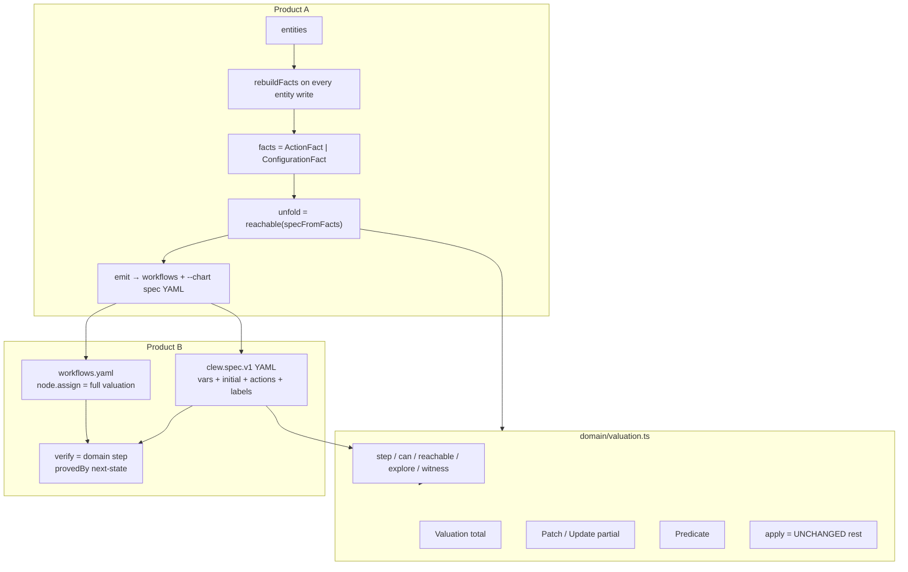
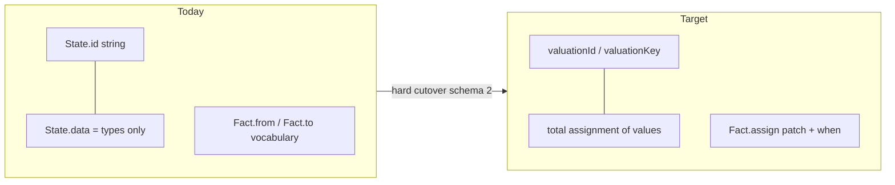
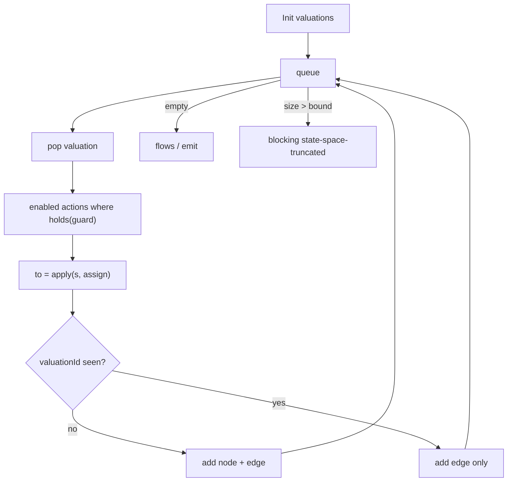
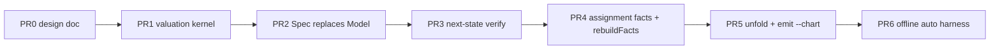

# TLA+ model redesign (Clew)

> **Status.** Design for stacked PRs. Arena base = candidate 2. Grafts from candidates 1 and 3. Do not merge until Jeff reviews.
>
> **Identity.** A state is one complete valuation of the closed variable set. Labels, workflow node ids, and fact ids are not identity. Equal valuations are the same state.
>
> **Offline corpus rule.** Private product specs stay offline. Never commit private corpus text or derived private tables.

## Architecture





## Spec pipeline

```mermaid
sequenceDiagram
  participant A as agent
  participant E as entities use case
  participant F as rebuildFacts
  participant U as unfold
  participant M as emit
  A->>E: list / merge / rename / promote / reject
  E->>F: sentences + tagged + entities + previous facts
  F-->>E: ActionFact + ConfigurationFact
  Note over E,F: same store write; no stale-graph
  A->>U: spec graph build
  U-->>A: reachable valuations + path cover (flows overlay)
  A->>M: spec emit --out workflows.yaml --chart spec.yaml
  M-->>A: workflows with full assign maps + clew.spec.v1
```



## Settings

> **Chart kind.** YAML must set `kind: clew.spec.v1`. Location-id charts fail schema with a migration hint. No dual loader.
>
> **Reach bound.** Default `limits.maxStates` / `CLEW_REACH_BOUND` = 5000. Truncation is blocking. Treat offline overflow as a propose bug first, then raise the bound if needed.
>
> **Labels.** Optional. Match a patch (or full valuation). Ambiguous label → finding. Labels never feed `step` or `valuationId`.
>
> **Workflow node.** `id` = visit. `assign` = full valuation after the step. Emit writes full maps. Hand-authored YAML may use a label or a partial map; verify resolves to exactly one reachable valuation or reports `name-gap` / `ambiguous-state`.
>
> **Sessions.** Global per OS user (`CLEW_DATA_DIR` / XDG). Project-agnostic. Spec schema version 2. Delete persisted `graph.json` on first v2 write; keep a flows overlay for agent split/group.
>
> **Parse boundary.** Zod only in YAML/JSON loaders and the store. Domain builds field by field. No `**` object unpacking.
>
> **XState.** View/analyze projection only. Verify uses domain `step`. `provedBy: 'next-state'`.

## Usage sketch

```yaml
kind: clew.spec.v1
id: todoTask
vars:
  - { id: phase, type: atom }          # draft | todo | in_progress | ...
  - { id: listed, type: boolean }
  - { id: title, type: atom }
initial:
  phase: draft
  listed: false
  title: ""
actions:
  - event: SUBMIT
    actor: user
    when: { op: and, of: [{ op: eq, var: phase, value: draft }, { op: neq, var: title, value: "" }] }
    assign: { phase: todo, listed: true }
labels:
  - { match: { phase: draft }, text: Draft }
```

```yaml
# workflow node after emit
nodes:
  - { id: n1, assign: { phase: draft, listed: false, title: "" } }
  - { id: n2, assign: { phase: todo, listed: true, title: "x" } }
edges:
  - { from: n1, event: SUBMIT, to: n2, text: "…" }
```

Fact shapes after entities:

- **ActionFact.** `event`, `actor?`, `when` (predicate), `assign` (patch). Signature includes event + when + assign keys.
- **ConfigurationFact.** `init` | `terminal` | `forbidden` over a predicate or attempted assign.
- Deleted as first-class kinds: vocabulary `from`/`to` strings, lone `performs`/`transition`/`guard` without assign.

`rebuildFacts` runs inside every entity command write. `proposeFacts` fills ActionFacts from SVO frames: object vars default `null` until assigned; action lemma → event; condition entities → boolean vars (so “else” is a value, not a missing fact).

## Module map

| Module | Owns |
|--------|------|
| `domain/valuation.ts` | Value, Valuation, Patch, Predicate, `apply`, `holds`, `valuationId`, `explore`/`reachable`, `witness` |
| `domain/spec-model.ts` (replaces location `Model`) | Spec, Action, Label, `step`, `can`, invariants |
| `domain/spec-facts.ts` | ActionFact, ConfigurationFact, `proposeFacts`, `rebuildFacts`, `specFromFacts` |
| `domain/spec-graph.ts` | unfold, path cover, emit drafts; no authoritative `graph.json` |
| `domain/workflow.ts` | visit nodes with `assign`; resolve label/partial |
| `domain/verification.ts` | next-state replay via `step` |
| `adapters/yaml/spec-loader.ts` | Zod `clew.spec.v1` |
| `adapters/spec-store/*` | schema 2, FactSchema, unlink `graph.json` |

## Stacked PRs (open as ready, do not merge)



| PR | Delivers | Check |
|----|----------|-------|
| **0** | This doc in repo `docs/tla-model-redesign.md` | Doc-only review |
| **1** | `domain/valuation.ts` + unit tests | Same pairs → same id; `apply` leaves others equal |
| **2** | `clew.spec.v1` loader; todo example rewritten; reject location charts | `chart check` on new todo; old YAML fails with hint |
| **3** | Workflow `assign`; verify via `step`; XState view-only | `verify` todo round-trip; bad assign fails |
| **4** | Fact schema v2; `rebuildFacts` on entity writes; propose writes patches | Promote changes facts; no `pastParticiple` `to` |
| **5** | Unfold, emit workflows + `--chart`, drop `graph.json`, delete `stale-graph` | emit → verify without hand location chart |
| **6** | Synthetic always-on CI harness | init→emit on synthetic fixture; no private corpus |

## Open questions for Jeff

1. Default reach bound 5000 vs 10000 once condition booleans expand the space?
2. Should `spec emit --chart` become the only chart source for offline, or keep hand-authored `clew.spec.v1` as first-class forever?
3. Atom domains: closed enums in YAML vs open strings with propose-time discovery?

## Arena note

Base candidate 2. Grafted C1 explore/witness, condition-as-bool, emit chart, partial state resolution. Grafted C3 ActionFact/ConfigurationFact wording. Rejected C3 `clew behavior` rename and single-file chart+workflows merge (keeps documented `chart` / `workflows` / `spec` commands).
