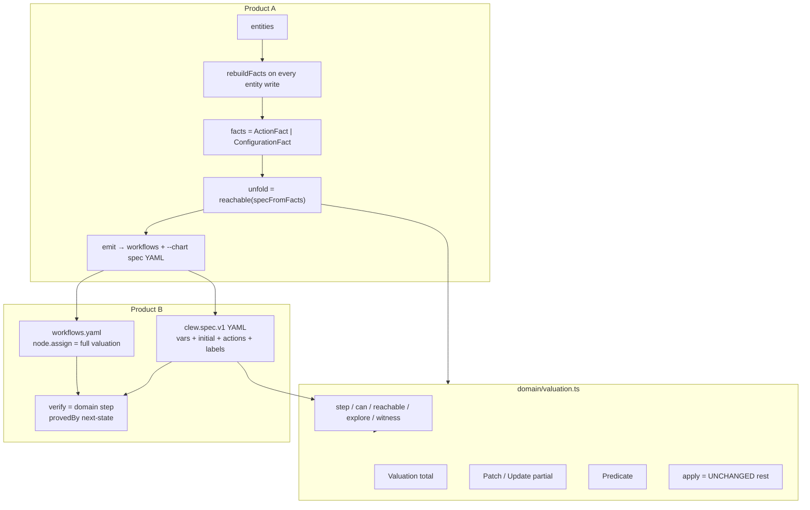
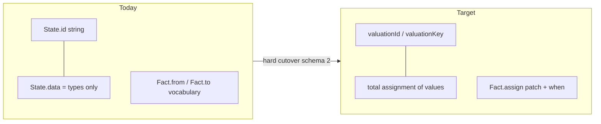
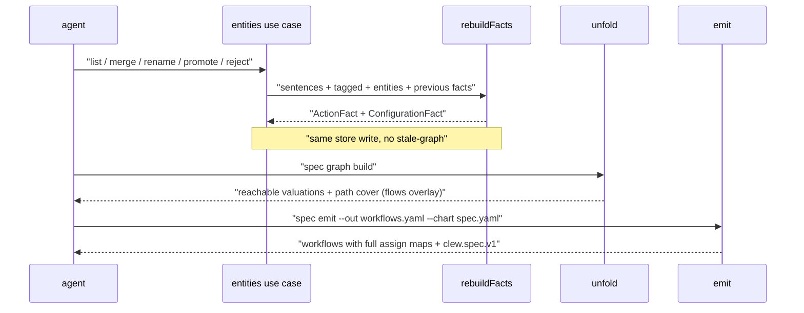
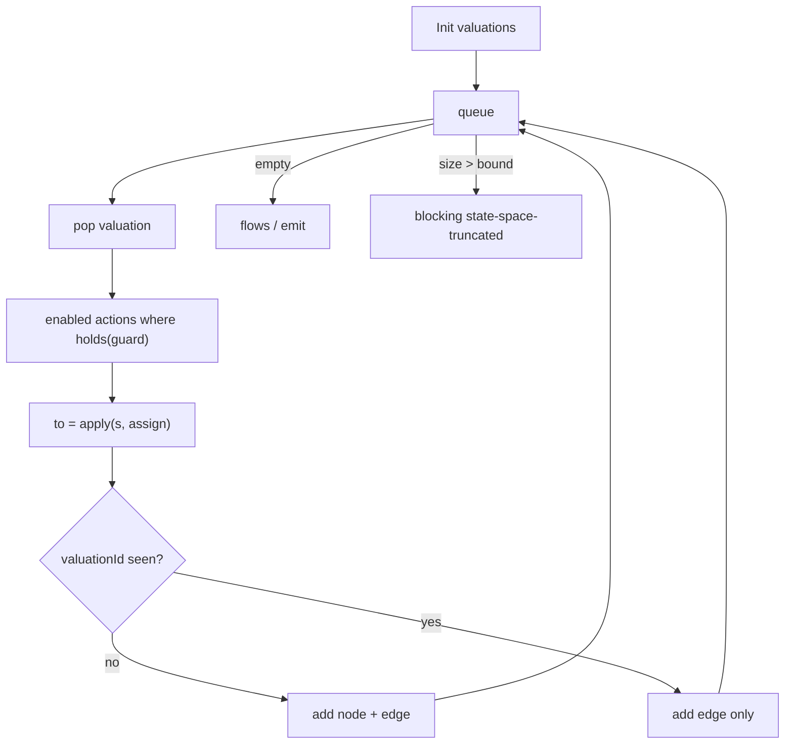
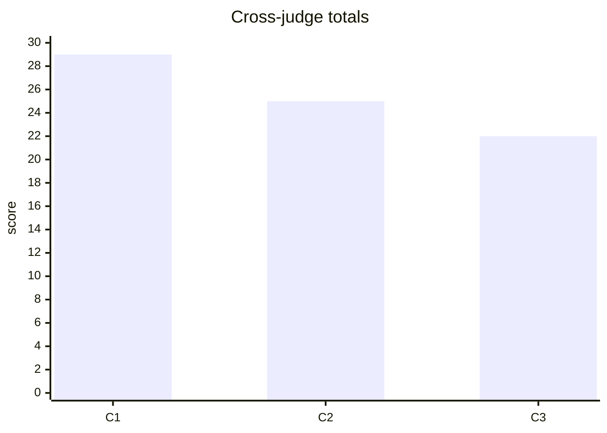

# TLA+ model redesign (Clew)

> **Status.** Design for stacked PRs. Do not merge until Jeff reviews.
>
> **Arena.** Three architecture candidates (C1–C3) were judged offline. Cross-judge scored **C1 29 / C2 25 / C3 22** and recommended C1. Shipping base is still **C2’s CLI surface**. See [Arena](#arena) below.
>
> **Identity.** A state is one complete valuation of the closed variable set. Labels, workflow node ids, and fact ids are not identity. Equal valuations are the same state.
>
> **Offline corpus rule.** Private product specs stay offline. Never commit private corpus text or derived private tables.
>
> **Stack.** Ordered open PRs live in Project context (`docs/project-context.md` in the Agent Store), not in this public doc.

## Architecture





## Spec pipeline





## Settings

> **Chart kind.** YAML must set `kind: clew.spec.v1`. Location-id charts fail schema with a migration hint. No dual loader.
>
> **Reach bound.** Default `limits.maxStates` / `CLEW_REACH_BOUND` = 5000. Truncation is blocking. Treat offline overflow as a propose bug first, then raise the bound if needed.
>
> **Labels.** Optional. Match a patch (or full valuation). Ambiguous label → finding. Labels never feed `step` or `valuationId`.
>
> **Workflow node.** `id` = visit. `assign` = **full valuation only** (no label or partial at verify time). Emit always writes full maps. Labels are display on the spec, never node identity.
>
> **Verify start.** Accepted flows must begin at a valuation reachable from `initial` (usually `initial` itself). Starting at an unreachable valuation fails. This closes the C2 sample-trace hole the cross-judge flagged.
>
> **Sessions.** Global per OS user (`CLEW_DATA_DIR` / XDG). Project-agnostic. Spec schema version 2. Delete persisted `graph.json` on first v2 write; recompute model/reach on read; keep flows overlays keyed by fact id for agent split/group.
>
> **Parse boundary.** Zod only in YAML/JSON loaders and the store. Domain builds field by field. No `**` object unpacking.
>
> **XState.** View/analyze projection only. Verify uses domain `step`. `provedBy: 'next-state'`.
>
> **Empty assign.** An action’s `assign` is non-empty (`NonEmptyAssignments`). Stutter is implicit, not an authored no-op action.
>
> **Stack green.** Each PR keeps the default product check green. Prefer C1’s “existing todo node states become labels on the migrated chart” for PR2 over skipped verify tests.

## Usage sketch

```yaml
kind: clew.spec.v1
id: todoTask
vars:
  - { id: phase, type: atom }          # draft | todo | in_progress | ...
  - { id: listed, type: boolean }
  - { id: title, type: atom }
initial:
  phase: draft
  listed: false
  title: ""
actions:
  - event: SUBMIT
    actor: user
    when: { op: and, of: [{ op: eq, var: phase, value: draft }, { op: neq, var: title, value: "" }] }
    assign: { phase: todo, listed: true }
labels:
  - { match: { phase: draft }, text: Draft }
```

```yaml
# workflow node after emit
nodes:
  - { id: n1, assign: { phase: draft, listed: false, title: "" } }
  - { id: n2, assign: { phase: todo, listed: true, title: "x" } }
edges:
  - { from: n1, event: SUBMIT, to: n2, text: "…" }
```

Fact shapes after entities (discriminated union; no `performs` join):

- **ActionFact.** `event`, `actor`, `when` (predicate), `assign` (non-empty patch). Actor lives on the action fact. Signature includes event + when + assign keys.
- **ConfigurationFact.** `init` | `terminal` | `forbidden` over a predicate or attempted assign.
- Deleted: vocabulary `from`/`to` strings; separate `performs` / `transition` / `guard` kinds that join by action name.

`rebuildFacts` runs inside every entity command write. `proposeFacts` fills ActionFacts from SVO frames: object vars default `null` until assigned; action lemma → event; condition entities → boolean vars (so “else” is a value, not a missing fact). `specFromFacts` / `modelFromFacts` produce the **same** `Spec` / draft the YAML loader parses.

## Module map

| Module | Owns |
|--------|------|
| `domain/valuation.ts` | Value, Valuation, Patch, Predicate, `apply`, `holds`, `valuationId`, `explore`/`reachable`, `witness` |
| `domain/spec-model.ts` (replaces location `Model`) | Spec, Action, Label, `step`, `can`, invariants |
| `domain/spec-facts.ts` | ActionFact, ConfigurationFact, `proposeFacts`, `rebuildFacts`, `specFromFacts` |
| `domain/spec-graph.ts` | unfold, path cover, emit drafts; no authoritative `graph.json` |
| `domain/workflow.ts` | visit nodes with `assign`; resolve label/partial |
| `domain/verification.ts` | next-state replay via `step` |
| `adapters/yaml/spec-loader.ts` | Zod `clew.spec.v1` |
| `adapters/spec-store/*` | schema 2, FactSchema, unlink `graph.json` |

## Results

Public-safe pipeline summary only. Measured private offline figures stay in the Agent Store and are omitted from this public doc. Jeff reviews the open stack; do not merge.

## Arena

Architecture arena produced three designs. A cross-family judge ([judge](bc-c2f16294-9b55-5fc7-a64e-00cf5a50bb94)) scored them against identity, action semantics, pipeline coherence, hexagonal fit, stackability, and offline-corpus testability.



| Candidate | Total | One-line shape |
|-----------|------:|----------------|
| **C1** | 29 | One valuation kernel; chart = TLA+ module; `modelFromFacts` ≡ loader draft; `explore`/`witness`; stack-green PR cut |
| **C2** | 25 | Chart = `clew.spec.v1`; strict `valuationId`; separate `chart` / `workflows` / `spec` files and CLI nouns |
| **C3** | 22 | Valuation-first behavior document; ActionFact / ConfigurationFact; merged behavior bundle + mega-PRs |

### Authorship (model / effort)

| Role | Model (effort) | Agent |
|------|----------------|-------|
| C1 author | `fable-medium` | [bc-36b5dee7…](bc-36b5dee7-4dda-5584-90c8-0270ad85d5b6) (`arena-candidate-1-fable`) |
| C2 author | `grok-xhigh-fast` | [bc-8a0b04db…](bc-8a0b04db-9e8e-5141-9cf6-c4714545ff43) (`arena-candidate-2-grok`) |
| C3 author | `gpt-5.6-sol-high` | [bc-84a726d2…](bc-84a726d2-998a-5352-8643-52174178df0e) (`arena-candidate-3-gpt`) |
| Cross-judge | Claude (cross-family; parent composer) | [bc-c2f16294…](bc-c2f16294-9b55-5fc7-a64e-00cf5a50bb94) — scored C1 29 / C2 25 / C3 22 |

### What each proposed

**C1 — one valuation kernel.** Pure `valuation.ts` (`Valuation`, `Predicate`, `Update`, `apply`, `explore`, `witness`). Chart is variables + init + actions + labels (no authored state list). Facts collapse toward action/status shapes; `modelFromFacts` and the YAML loader share one draft type; graph = `explore(model)`; emit can write `--chart`. Strongest stackability (each PR lands with product checks green; PR2 keeps todo verify green by turning old node states into labels).

**C2 — chart is a TLA+ spec.** Strictest identity: labels never feed `step`/verify; workflow nodes carry full `assign` only. Product A/B stay separate files (`chart` / `workflows` / `spec`). `specFromFacts` matches the loader; unfold not persisted; `graph.json` deleted. Weaker stackability (admitted red windows / skipped verify in mid-stack). Kept a `performs`-style actor join the redesign exists to remove.

**C3 — valuation-first behavior document.** Strong nominal `Valuation` branding; ActionFact (`allowed`/`forbidden`) + ConfigurationFact; `refreshFacts` on entity writes; stable attempt ids from fact id + source key. Costly: whole-product mega-PRs, single merged behavior document (emit verifies against itself — no independent chart oracle), and an auto path that needs agent-typed variables before it can run.

### Cross-judge judgement

Recommended base **C1** (29): one kernel/type for chart + facts + emit; invariants in constructors; only stack reviewable PR-by-PR with the product green; TLA+ fidelity where it matters (Init as a set, dead-ends legal, nondeterminism surfaced).

C2 won identity purity and boundary cleanliness but kept the actor join and red stack windows. C3 had the most literal fact shape but failed stackability and removed the independent chart oracle.

### Shipping decision (this redesign)

Keep **C2’s CLI / file surface** (`chart` / `workflows` / `spec`) because #44/#45 already ship on it and C3’s unified behavior bundle is rejected.

Absorb from **C1:** `explore`/`witness`, condition entities as boolean vars, `modelFromFacts` ≡ loader draft, `spec emit --chart`, stack-green PR2 label trick, Init as a set when YAML lists multiple initials.

Absorb **judge fixes vs C2:** drop `performs` join; full valuations only on workflow nodes; verify reachable-from-initial; no persisted authoritative `graph.json`.

Absorb from **C3:** ActionFact / ConfigurationFact; `NonEmptyAssignments`; stable attempt ids from fact id + source key. Reject C3 mega-PRs, forbidden-as-pseudo-action, and agent-typed variables before auto propose.